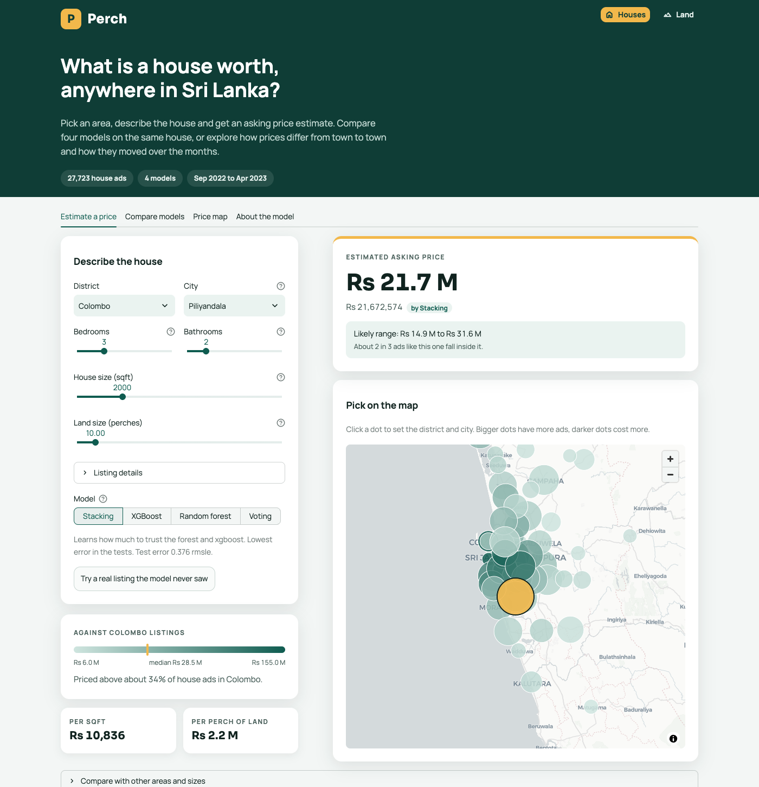
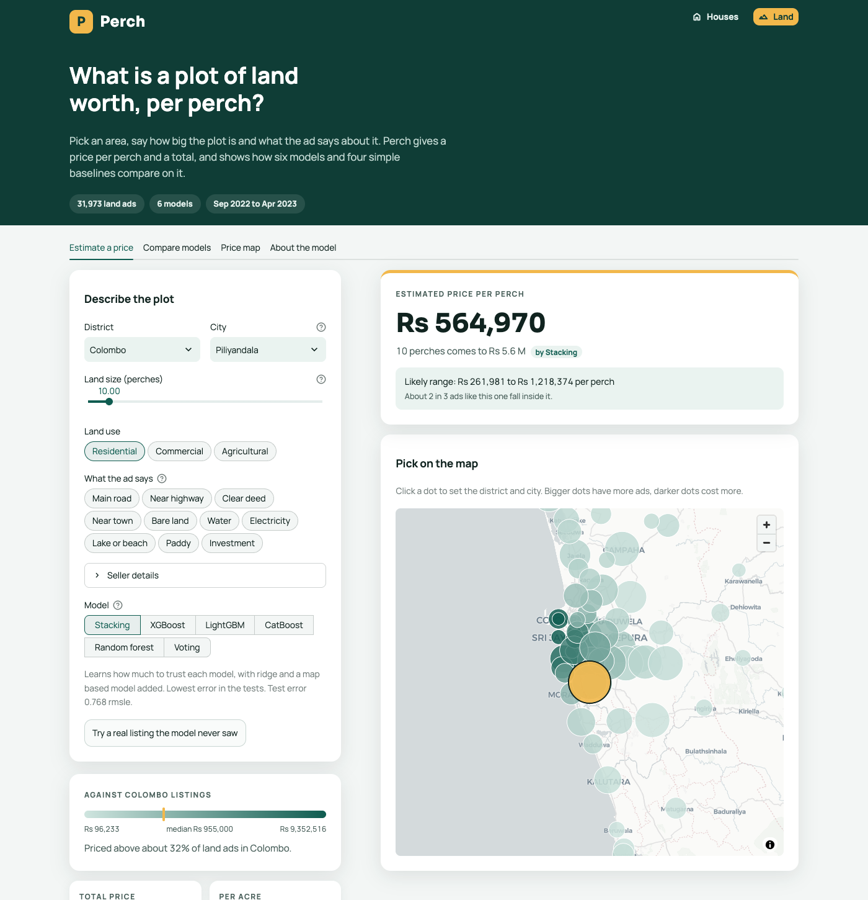
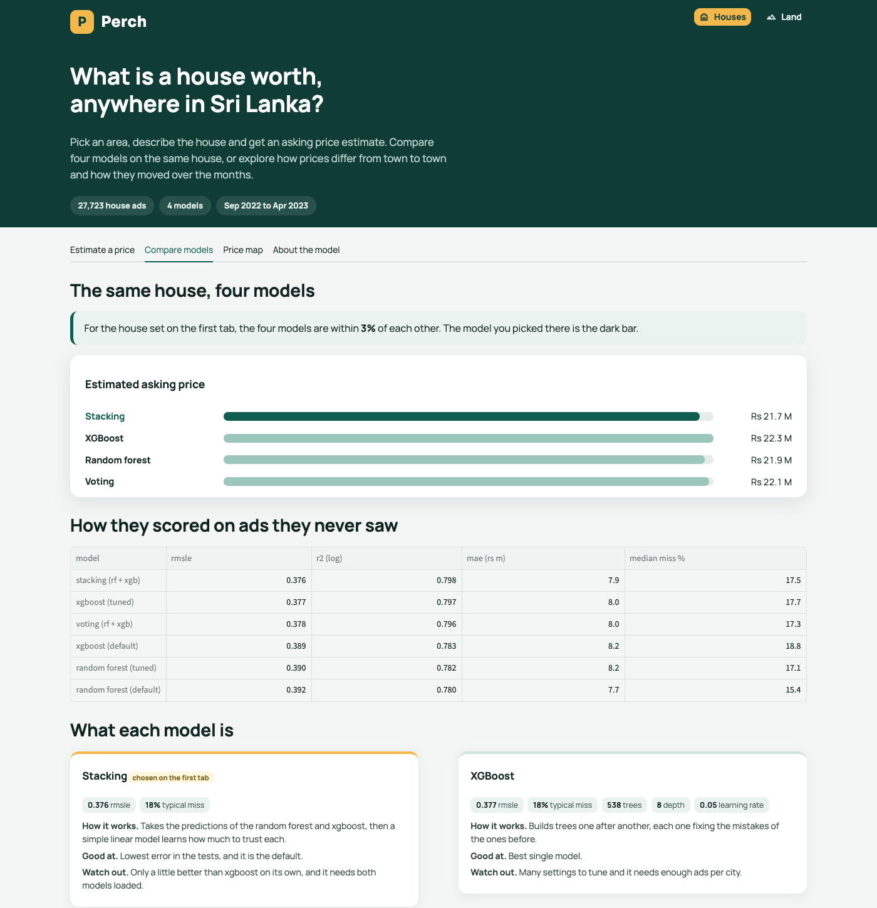
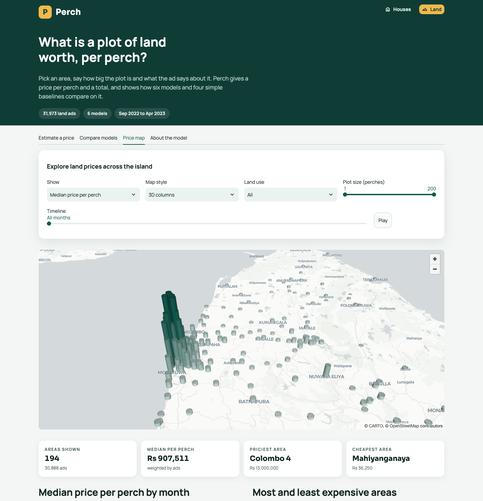

# Perch

lk-ensemble-lab: property price prediction for sri lanka with tree ensembles.

ensemble learning lab work on a sri lankan dataset. part 1 compares random forest and xgboost for predicting house prices, adds a voting and a stacking model and runs inference on one held out listing. part 2 takes a second case from the same ads, land price per perch, and adds lightgbm, catboost, a bigger stack and a comparison with simple baselines. both are served through a small web app called perch.

## the app

perch is a streamlit app with two pages, houses and land. each page has four tabs:

- **estimate a price**: pick the district and city from the lists or click a dot on the map, describe the house or plot, choose one of the models and get a price with a likely range, where it sits among the listings in that district, and a what-if chart for other areas and sizes. a button loads a real listing the model never saw and shows how far off the estimate is
- **compare models**: the same house or plot priced by every model side by side, the test scores of all models and baselines, and a card for each model with how it works, what it is good at and what to watch out for
- **price map**: 3d columns, heatmap or bubbles of median prices by area, filters, a timeline with play, and the most and least expensive areas
- **about the model**: how the estimate is made, what drives the price and, for land, the leave-features-out check and the stack weights

<table>
  <tr>
    <th>houses</th>
    <th>land</th>
  </tr>
  <tr>
    <td></td>
    <td></td>
  </tr>
  <tr>
    <td></td>
    <td></td>
  </tr>
</table>

more screenshots, including the model comparison for land and the houses price map, are in `screenshots/`.

## deployment

the app is deployed on streamlit community cloud and open to anyone: [purch-lk.streamlit.app](https://purch-lk.streamlit.app/). it is built straight from the `main` branch, so every push redeploys it. a github actions workflow in `.github/workflows/deploy.yml` records each deployment under the repo environments.

## problem

part 1: predict the asking price (rs) of a house for sale in sri lanka from its bedrooms, bathrooms, house size, land size, location and a few seller details.

part 2: predict the asking price per perch (rs) of a plot of land from its size, land use, location, seller details and words used in the ad. both are regression problems.

## data

- house and land ads from ikman.lk, [sri lanka property ads dataset](https://www.kaggle.com/datasets/ivantha/sri-lanka-property-ads-dataset) on kaggle by ivantha. covers sep 2022 to apr 2023. the ad content belongs to the original posters, so the repo only keeps cleaned numeric files
- about 70% of land ads are reposts (same price, size and location), so they are removed before splitting to avoid leakage
- land prices come in different units, so everything is converted to rs per perch (per acre is divided by 160)
- location coordinates for the map are looked up with openstreetmap nominatim

## results: houses

scored on a 20% test set (rmsle on log price, lower is better):

| model | rmsle | r2 (log) | median error |
|---|---|---|---|
| random forest (default) | 0.392 | 0.780 | 15.4% |
| xgboost (default) | 0.389 | 0.783 | 18.8% |
| random forest (tuned) | 0.390 | 0.782 | 17.1% |
| xgboost (tuned) | 0.377 | 0.797 | 17.7% |
| voting (rf + xgb) | 0.378 | 0.796 | 17.3% |
| stacking (rf + xgb) | 0.376 | 0.798 | 17.5% |

xgboost beats the random forest, and voting and stacking add very little on top. the app lets you choose between stacking (default), xgboost, random forest and voting. details, strengths, limitations and interpretation are in `notebooks/houses_modelling.ipynb`.

## results: land

scored on a 20% test set (rmsle on log price per perch, lower is better):

| model | rmsle | r2 (log) | median error |
|---|---|---|---|
| district median | 1.083 | 0.308 | 58.7% |
| location median | 0.920 | 0.502 | 35.2% |
| ridge | 0.847 | 0.577 | 39.1% |
| knn (location + size) | 0.883 | 0.541 | 36.7% |
| random forest (tuned) | 0.778 | 0.644 | 31.5% |
| xgboost (tuned) | 0.769 | 0.651 | 32.3% |
| lightgbm (tuned) | 0.777 | 0.644 | 32.8% |
| catboost (tuned) | 0.778 | 0.644 | 33.1% |
| voting (4 trees) | 0.770 | 0.651 | 32.1% |
| stacking (trees + ridge + knn) | 0.769 | 0.652 | 31.8% |

all the tree models beat the baselines clearly, but they are very close to each other and the stack is only about 0.001 better than xgboost, which is inside the noise. a typical miss is still around 32%, because the ads say little about the plot itself. the app lets you choose between six land models. shap, a leave-features-out check and the stack weights are in `notebooks/land_modelling.ipynb`.

## models

houses (part 1): random forest, xgboost, voting (average of the two) and stacking (a linear model on top of the two). random forest and xgboost are tuned with a randomized search.

land (part 2): random forest, xgboost, lightgbm and catboost, each tuned, plus voting over the four and two stacks. the final stack adds ridge and a nearest neighbour model on the map, and a non negative linear model learns the weights. the four simple baselines (district median, location median, ridge, knn) show what the trees have to beat.

all models predict the log of the price and are scored on a 20% test set. the app reads the saved pipelines in `model/`, so preprocessing is part of each pickle.

## structure

```
data/raw         kagglehub downloads (not tracked)
data/processed   cleaned houses, cleaned land and location coordinates
notebooks/       house eda and modelling, land eda and modelling, location coordinates
model/           pickled pipelines, held out samples, app metadata
estimators.py    lightgbm and catboost wrappers needed to unpickle the land model
frontend/        streamlit app (perch) with a houses and a land page, and its spec
.github/         deployment workflow
screenshots/     app screenshots
```

notebooks run in order: `houses_eda`, `houses_modelling`, `locations`, `land_eda`, `land_modelling`.

## setup

```
python3 -m venv .venv
source .venv/bin/activate
pip install -r requirements.txt
```

on a mac xgboost and lightgbm also need openmp: `brew install libomp`.

## run the app locally

```
streamlit run frontend/app.py
```

## limitations

- asking prices, not sale prices
- 7 months of ads, so the timeline says nothing about long term trends
- colombo and gampaha make up most of the data, small districts have large errors
- the land model is about a third off on a typical plot, so treat it as a rough guide
- `model/land_stacking.pkl` is about 52 MB
